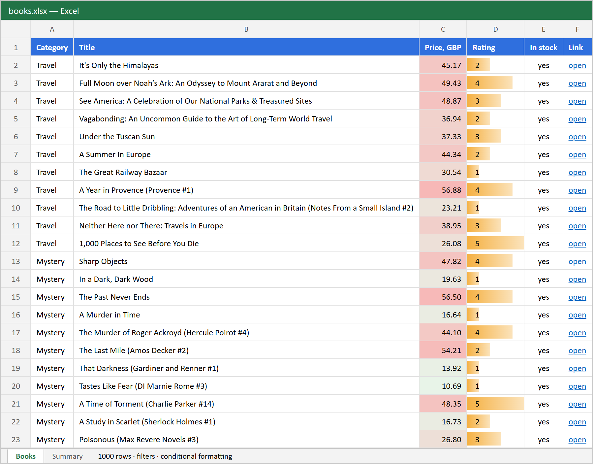
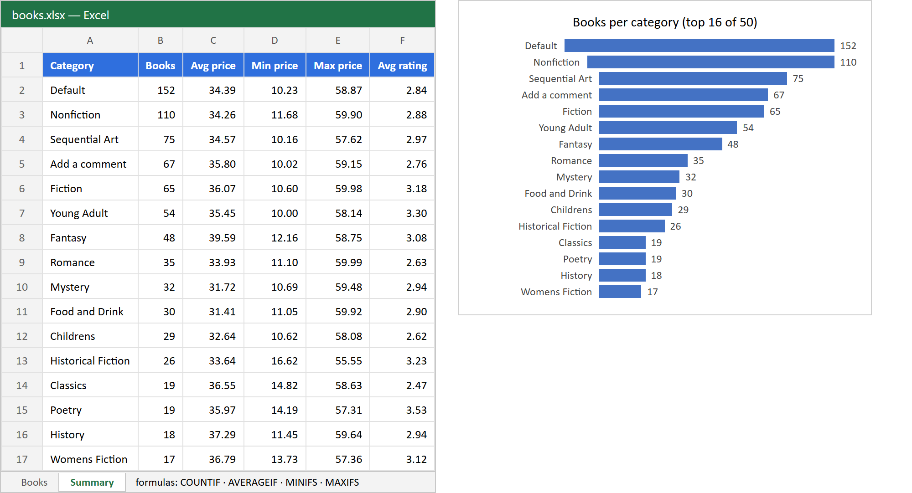

# Books catalogue scraper → Excel report

Python script that collects the full catalogue of [books.toscrape.com](https://books.toscrape.com/) (a public sandbox made for scraping practice) and builds a ready-to-use Excel report.



## What it does

- Walks all 50 categories, follows pagination, and collects **1000 books**: category, title, price, rating (1–5), stock status, and a link.
- Polite crawling: a delay between requests, a timeout, and retries with backoff.
- Excel output (`openpyxl`):
  - **Books** sheet with a frozen header, autofilter, a colour scale for price, data bars for rating, and clickable links;
  - **Summary** sheet with live formulas (`COUNTIF`, `AVERAGEIF`, `MINIFS`, `MAXIFS`) per category, plus a bar chart.



## Run

```bash
python -m venv .venv
.venv/Scripts/pip install -r requirements.txt      # Linux/macOS: .venv/bin/pip
.venv/Scripts/python scraper.py                    # -> books.xlsx
.venv/Scripts/python scraper.py --out report.xlsx --delay 0.5 --max-categories 5
```

A full run takes about 30 seconds and makes about 70 requests.

## Adapting it to a real site

The same structure (client with retries → page parser → export) is what I use for client work: online stores, catalogues, price monitoring. The output can also go to CSV, Google Sheets or a database, and the script can run on a schedule.

> The site data belongs to the books.toscrape.com sandbox. Category names such as "Default" and "Add a comment" come from the site as-is.
